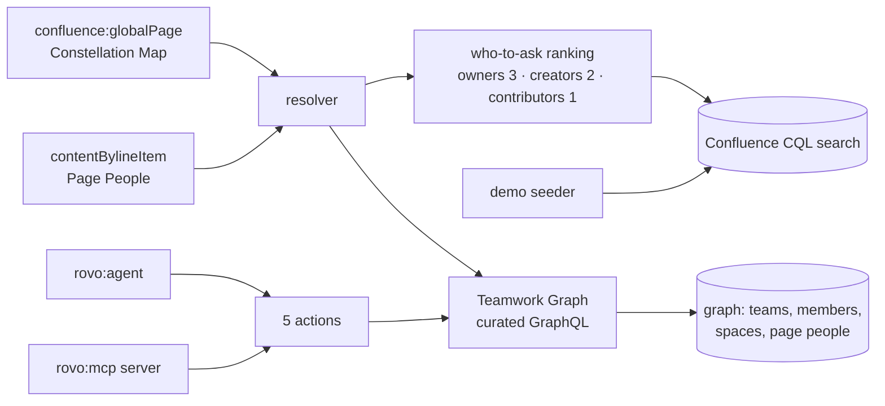

# ✨ Constella

**The team knowledge satellite for Confluence.** A Forge app for Codegeist 2026
that maps people ↔ teams ↔ spaces ↔ pages through the Atlassian Teamwork Graph —
so you always know who is behind the knowledge, and who to ask before you write.

> Every company has two org charts: the reporting line and the real one — the
> people who actually wrote the pages. Constella maps the second one.

## Judge quick path (fresh site, 60 seconds)

> **Install (approve ALL requested scopes — the Teamwork Graph ones are the
> app's lifeblood) → Confluence → Apps → Constella → "Generate demo content".**
> The seeder creates the `CONSTELLADEMO` space with 4 pages (onboarding, HR
> policy, launch plan, incident runbook) and sets you as their owner. Give the
> graph ~a minute to index, reload, then try "Who should I ask? → onboarding"
> and open any demo page's byline chip.

## What it does

| Surface | Module | What the user gets |
|---|---|---|
| **Constellation Map** (global page) | `confluence:globalPage` | Your teams, their members, and their linked Jira + Confluence spaces — live from the graph |
| **Page People byline item** | `confluence:contentBylineItem` | Creator, owners, and recent contributors of the open page |
| **Constella Guide agent** | `rovo:agent` + `rovo:mcp` | Chat queries + 5 MCP tools for your own agents: page people, space teams, user teams, recent work, who-to-ask |
| **Who to ask** | resolver + CQL search | Topic → ranked people (owners weighted above contributors) |

## Why Teamwork Graph

The rules' judging criteria reward "genuine, working, non-trivial
implementation." Constella is a graph-native app: every surface resolves its
data through curated Teamwork Graph queries (`atlassianUserInTeams`,
`atlassianTeamMembers`, `spacesByAtlassianTeam`, `atlassianTeamsBySpace`,
`confluencePageCreator/Owners/Contributors`, `atlassianUserRecentlyViewed`,
`atlassianUserAssignedJiraWorkItems`) — no REST scraping, no sync jobs, no
external database. Remove the graph and the app has nothing to show.


## Architecture



## Quick start

```bash
npm install -g @forge/cli@latest
npm install
forge register   # put your app id in manifest.yml
forge deploy
forge install    # your site, e.g. example.atlassian.net
```

Then:
1. Confluence → Apps → **Constella** → your constellation appears (needs at
   least one Atlassian team in the team directory).
2. Open any page → hover the byline → **Constella — page people**.
3. Rovo chat → browse agents → **Constella Guide** → "Which teams work in the
   Marketing space?"

> **Graph data note:** Teamwork Graph scopes must be granted by the site admin
> during install. Missing scopes silently return partial data (documented TWG
> behavior) — the UI degrades gracefully with an explanation instead of errors.

## Architecture

```
src/backend/twg-client.js        curated TWG GraphQL queries → plain objects
src/backend/confluence-client.js CQL page search (who-to-ask entry point)
src/index.js                     resolver + 5 actions + whoToAsk ranking
src/frontend/index.jsx           Constellation Map + Page People (one resource)
prompts/guide-agent-prompt.txt   agent system prompt (read-only boundaries)
tests/who-to-ask.test.js         ranking logic: weights, aggregation, fallbacks
```

**Design principles**
- *Graph-native*: data comes from TWG curated queries, not REST scraping.
- *Read-only by design*: no write scopes at all — nothing to abuse.
- *Graceful degradation*: every wrapper returns `[]` on failure, with reasons
  surfaced in the UI.
- *Judge-installable*: `forge deploy` + install link, zero external services.

## Tests

```bash
npm test   # vitest — who-to-ask ranking: owner/creator/contributor weights,
           # cross-page aggregation, empty results, error fallbacks
```

## License

Apache-2.0 — see [LICENSE](LICENSE).
